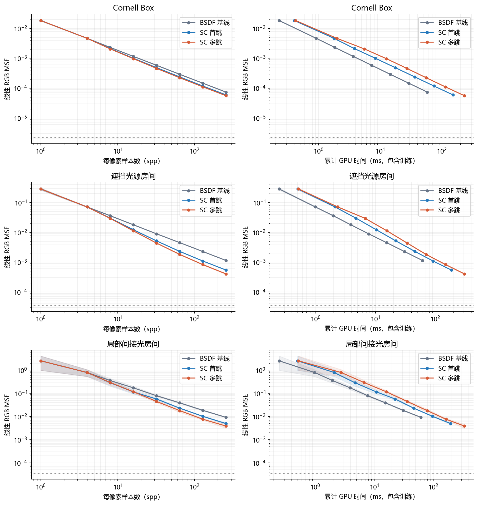
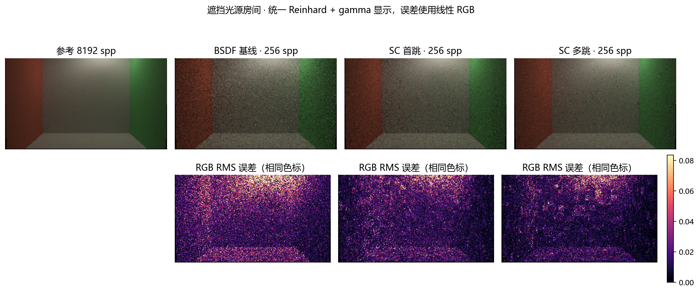

# Significance Cache：实现与 Vulkan 实验

本插件实现了 Bashford-Rogers、Debattista 和 Chalmers 的 **A Significance Cache for Accelerating Global Illumination** 中的表面路径引导方法：缓存连续的有向幂余弦波瓣，以 BRDF、余弦项和缓存亮度共同选择波瓣，再用真实混合 PDF 计算路径权重。论文发表于 Computer Graphics Forum 31(6), 1837–1851, 2012。参考 [作者公开预印本](https://www.thomasbashfordrogers.com/Papers/SC.pdf) 的 §3.2–3.4、公式 (2)–(12) 和 Algorithm 1；[出版信息](https://wrap.warwick.ac.uk/id/eprint/46922/)。

## 在 Mogwai 中使用

默认入口 [path_reuse.py](../../../scripts/my_graph/path_reuse.py) 会执行 [SignificanceCache.py](../../../scripts/SignificanceCache.py)，后者通过 `m.addGraph()` 注册同名图。按现有 Mogwai 运行配置启动后，在 **Active Graph → SignificanceCache** 中选择即可。图中连接 `VBufferRT → SignificanceCache → AccumulatePass → ToneMapper`，默认开启累计。

本机实验确认了同 spp 的降噪效果，但当前 GPU 版本在同时间预算下没有获得加速。下文同时给出误差、GPU 时间和消融结果。

所有运行验证与实验使用 **Vulkan**。本任务没有运行 D3D12 验证。

```powershell
# 在已加载 MSVC 2022 和 Windows SDK 的开发者 PowerShell 中执行。
cmake --build build/clion-release --config Release --target SignificanceCache Mogwai
$env:FALCOR_DEVMODE = '1'
& ./build/clion-release/bin/Release/Mogwai.exe --device-type vulkan --script scripts/my_graph/path_reuse.py --scene resource/CornellBox/CornellBox.pyscene
```

## 算法与工程实现

**连续波瓣与混合采样。** 每个缓存记录保存世界空间位置、方向、平均入射亮度、全部样本的平均亮度、浮点指数 `e`、样本数 `S`、有用样本累计 `Sr` 和全部样本累计 `Sa`。采样时使用整数指数 `n = ceil(e)`，默认从附近记录中选取最近的四个有效记录，按 `luminance(BSDF.eval(direction)) × cachedRadiance` 加权。Falcor 的 `BSDF.eval()` 已包含余弦项。默认以 50% 概率采样缓存，其余采样 BSDF：

```text
p(w) = (1 - guideMix) pBSDF(w) + guideMix × Σ wi Di(w) / Σ wi
```

路径贡献除以这个实际 PDF，发光三角形 NEE 和散射命中的 MIS 也使用它。完美镜面、透射和不适用材质直接使用 BSDF。保留至少 10% 的 BSDF 分支确保继续探索原采样器的支持域。

**倾斜波瓣的正确归一化。** 先在波瓣自己的半球按幂余弦分布采样，再拒绝几何表面下方的方向。对 `c = dot(lobeAxis, surfaceNormal) ≥ 0`，保留的概率质量为：

```text
A(n, c) = 1/2 + 1/2 × I_(c²)(1/2, (n+1)/2)
Di(w) = (n+1) max(dot(lobeAxis, w), 0)^n / (2π A(n,c))
```

这里 `I` 是正则化不完全 beta 函数。实现用整数幂积分递推直接计算，不需要数值积分或查表。接受率至少为 1/2。平面上复用更新阶段预计算的归一化常数；只有法线逐分量完全相同时才复用，其他情况重新计算，避免近似法线带来的 PDF 偏差。

**在线自适应。** 按论文使用 `s = max(dot(axis,w),0)^e` 评估方向相关性，以 `abs(Lcached - Lin) < 0.5 Lcached` 判断有用样本，更新 `Sr`、`Sa` 并令 `e = max(Sa/Sr - 1, 1)`。亮度高于均值且 `s ≥ 0.5` 时更新波瓣方向和亮度。没有适合的记录时插入新波瓣。指数加数值上限，新记录使用有限小先验。

每条路径结束后，反向重建各次散射的路径后缀，取得训练用入射辐亮度，避免除以 RGB 吞吐量的零分量。已由发光面 NEE 处理的首段发光命中只进入成像，不进入该段的间接光训练；后续 NEE、间接反射和没有 NEE 的环境贡献参与训练。

**GPU 调度。** 射线查询和着色在计算着色器内执行。一个渲染调度只读取已经发布的记录，同时把训练样本写入独立缓冲；帧结束后，每格一个计算线程串行更新该格的记录。抽样过程中分布保持固定，因此缓存自适应不会把当前样本反馈到自己的 PDF。

主要文件：

- [SignificanceCache.cs.slang](SignificanceCache.cs.slang)：路径追踪、发光面 MIS、后缀训练。
- [CacheGuide.slang](CacheGuide.slang)：近邻查询、BRDF 乘积权重、采样与 PDF。
- [CacheTypes.slang](CacheTypes.slang)、[CosineLobe.slang](CosineLobe.slang)：记录结构、归一化、截断波瓣采样。
- [UpdateCache.cs.slang](UpdateCache.cs.slang)：波瓣插入、方向和指数自适应。
- [SignificanceCache.cpp](SignificanceCache.cpp)：Falcor 接口、资源分配、更新调度和配置面板。

## 与论文实现的区别

这是有界存储的 GPU 表面路径追踪版本。默认使用 `16³` 个格子，每格最多八个波瓣、每批最多 32 个训练样本。查询默认只搜索所在格的最近四个有效记录；`searchNeighborCells=true` 时扩展到相邻 27 格。距离上限为一个格子的对角线长，波瓣轴须指向当前几何表面上半球。更新处理所属格的全部记录，不跨格写入。

训练缓冲采用饱和原子计数，只保留该批次最先提交的 32 个样本；不是随机水库。满格后忽略新记录，满批后忽略额外训练样本，所有渲染样本仍正常进入成像。这些限制影响引导质量与适应速度，不改变成像使用的混合 PDF。GPU 线程提交顺序可能导致重复运行的缓存状态略有差异。

默认缓存缓冲合计约 **8.02 MiB**，不含图像、场景及驱动的着色器临时存储。记录通过设置种子、修改参数、换场景，或受支持的几何、材质、灯光、环境与渲染设置变化而清空。仅相机运动时保留缓存，方便新视角继续学习。

缓存用于不透明 Standard 和 PBRTDiffuse 三角面的连续反射；其他表面由 BSDF 追踪。没有实现论文的参与介质、光源端追踪和 MLT 扩展，也没有复现论文原始 CPU 场景及其性能数字。

## 参数

创建实例时传入属性字典；运行中的实例接受 `set_properties()`。未知属性会记录警告，非法范围在修改现有配置前抛出异常。

| 参数 | 默认值 | 含义 |
| --- | ---: | --- |
| `enableGuiding` | `true` | 开启缓存训练和采样 |
| `maxBounces` | `6` | 最大间接反弹数，0–16；末段保留发光命中以配对 MIS |
| `guidedBounces` | `6` | 最多参与引导的反弹数，0–16；1 表示仅主命中 |
| `queryLobes` | `4` | 每次查询保留的最近有效波瓣数，1–8；改变时重新编译该着色器变体 |
| `guideMix` | `0.5` | 缓存分支概率，0–0.9 |
| `gridResolution` | `16` | 每轴格数，1–32 |
| `searchNeighborCells` | `false` | 查询相邻格，开销更高 |
| `warmupFrames` | `4` | 首次发布缓存前的帧数；0 按 1 帧处理 |
| `updateInterval` | `4` | 后续发布间隔，必须为正 |
| `maxExponent` | `64` | 波瓣指数上限，1–128 |
| `minRoughness` | `0.05` | 使用缓存的最低粗糙度，0–1 |
| `seed` | `0` | 从该随机序列偏移重新开始，并清空缓存和累计 |

`color` 输出线性 HDR RGBA；`guide` 输出主命中的 `(有效波瓣数, 平均整数指数, 实际引导概率, 是否可训练)`，可在 Mogwai 中查看以检查缓存是否工作。

## 验证与复现

实验和验证脚本使用 NumPy。让 Mogwai 的内嵌 Python 3.10 访问兼容的本机包目录：

```powershell
$env:FALCOR_DEVMODE = '1'
$env:PYTHONPATH = (& python -c 'import site; print(site.getsitepackages()[-1])')

# 波瓣归一化与采样矩：28 组，每组 262144 个 GPU 样本。
& ./build/clion-release/bin/Release/Mogwai.exe --headless --device-type vulkan --width 16 --height 16 --script scripts/my_graph/validate_significance_cache_lobes.py

# 默认图注册、切换、配置校验、缓存重置和直接光退化检查。
& ./build/clion-release/bin/Release/Mogwai.exe --headless --device-type vulkan --width 96 --height 64 --script scripts/my_graph/validate_significance_cache.py

# 正式实验。
& ./build/clion-release/bin/Release/Mogwai.exe --headless --device-type vulkan --width 256 --height 144 --script scripts/my_graph/benchmark_significance_cache.py

# 使用本机 Python 和 Matplotlib 生成静态科学图表。
python scripts/my_graph/analyze_significance_cache.py
```

验证直接调用正式 Slang 波瓣采样器和积分函数，以独立的均匀半球数值积分核对 PDF 与样本矩，覆盖指数 1、2、3、8、32、64、128 和法线夹角余弦 0.001、0.25、0.7、1。运行验证覆盖默认启动图注册、无场景清空、预热、快照发布、参数与种子重置、格子尺寸改变、邻格查询、材质发光强度与光源开关变化，以及相机移动和 0 次反弹。

基线另与原 `MyPathTracer` 和关闭光子引导的 `PhotonMapPathTracer` 比较。两种 inline 实现应几乎逐值相同；与使用光线追踪管线的 `MyPathTracer` 比较平均亮度，允许遍历数值差异造成的少量像素差异。

`SC_SMOKE=1` 运行短测试；`SC_SCENE` 可选择 `CornellBox`、`IndirectRoom` 或 `FocusedRoom`。`SC_TRIALS`、`SC_MAX_SPP`、`SC_REFERENCE_SPP`、`SC_FOCUSED_REFERENCE_SPP`、`SC_QUERY_LOBES` 和 `SC_OUTPUT_PREFIX` 可调整试验规模与输出前缀。正式复现前清除这些环境变量。

原始逐轮数据与线性图像保存于 `build/significance-cache-experiment/`。可版本控制的结果和图表保存于 [Experiments](Experiments/)，实验方法及结果见下文。

## 实验方法

GPU 为 RTX 2070 8 GiB，驱动 610.88，Vulkan、Release、256×144。固定像素中心，最多六次间接反弹。比较 BSDF、SC 首跳和 SC 多跳三种模式。每组使用六个独立种子，从空缓存开始累计至 256 spp，同轮共用随机序列偏移并轮换执行顺序。

Cornell Box 使用仓库已有场景；[遮挡光源房间](../../../scripts/my_graph/scenes/SignificanceCacheIndirect.pyscene) 和 [局部间接光房间](../../../scripts/my_graph/scenes/SignificanceCacheFocused.pyscene) 使用程序化几何，不需要外部资源。后者缩小朝上发光的灯面并贴近顶棚，在保持近似相同总光通量的同时，缩小直接照亮的顶棚区域，用于检查更局部的间接照明。相机避开灯面及顶棚。

前两个场景的 BSDF 参考图为 8192 spp，局部间接光场景为 65536 spp；每个参考由两个独立种子的等长累计平均而成。用两半参考的差异 MSE 除以四，估计完整参考的剩余噪声。MSE 在累计后的线性 RGB 上用双精度计算。

GPU 时间包括 `VBufferRT`、完整 `SignificanceCache` 调度以及 `AccumulatePass`。缓存清空、预热和每四帧更新的成本全部计入。预先执行管线以排除着色器编译，再重设种子和缓存后开始测量；不计 CPU、图像读回和分析耗时。各检查点报告六轮平均 MSE 与累计 GPU 时间中位数。同时间对照在这些曲线上做 log-log 插值，不外推；图中的阴影为均值标准误的 1.96 倍，虚线为参考噪声估计。

## 实验结果

默认四波瓣、多跳引导在 256 spp 下，将三个场景的平均 MSE 分别降低 **24.3%、64.5%、57.9%**。以基线达到 256 spp 的累计 GPU 时间为预算，多跳引导的 MSE 分别约为基线的 **2.90、1.89、2.60 倍**；首跳引导也没有取得同时间收益。因此，本次实现验证了采样效率的提升，尚未复现论文宣称的总体时间效率收益。

缓存的 BRDF 乘积评估、局部记录查询、拒绝采样和额外 PDF 评估在这些廉价几何场景中占比较高。六轮平均亮度相对参考的偏差绝对值均小于 0.35%；这一检查用于发现明显能量错误，有限试验不构成无偏性证明。每轮 256 帧均从空缓存开始，记录到一次清空、64 次发布；最后一帧的有效引导像素比例在 Cornell Box 约为 57.1%，两个房间约为 99.5%。



### Cornell Box

参考图剩余噪声 MSE 估计：`2.22868e-06`。

| 模式 | 64 spp MSE | 256 spp MSE | GPU ms/帧 | 同 spp MSE 降幅 |
| --- | ---: | ---: | ---: | ---: |
| BSDF 基线 | 0.000291472 | 7.39954e-05 | 0.226 | 0.0% |
| SC 首跳 | 0.000238406 | 5.97472e-05 | 0.590 | 19.3% |
| SC 多跳 | 0.000223666 | 5.60057e-05 | 0.904 | 24.3% |

| 相同 GPU 预算（ms） | BSDF MSE | SC 首跳 MSE | SC 多跳 MSE |
| ---: | ---: | ---: | ---: |
| 3.66 | 0.0011599 | 0.00221188 | 0.00286791 |
| 14.54 | 0.000291472 | 0.000584641 | 0.000845345 |
| 57.98 | 7.39954e-05 | 0.000150817 | 0.000214723 |

### 遮挡光源房间

参考图剩余噪声 MSE 估计：`3.52723e-05`。

| 模式 | 64 spp MSE | 256 spp MSE | GPU ms/帧 | 同 spp MSE 降幅 |
| --- | ---: | ---: | ---: | ---: |
| BSDF 基线 | 0.00453436 | 0.00114207 | 0.238 | 0.0% |
| SC 首跳 | 0.00230054 | 0.000544561 | 0.727 | 52.3% |
| SC 多跳 | 0.00182029 | 0.000404932 | 1.201 | 64.5% |

| 相同 GPU 预算（ms） | BSDF MSE | SC 首跳 MSE | SC 多跳 MSE |
| ---: | ---: | ---: | ---: |
| 3.87 | 0.0179727 | 0.0371098 | 0.0468409 |
| 15.31 | 0.00453436 | 0.00780603 | 0.0114922 |
| 61.04 | 0.00114207 | 0.00169013 | 0.00215878 |

### 局部间接光房间

参考图剩余噪声 MSE 估计：`3.49401e-05`。

| 模式 | 64 spp MSE | 256 spp MSE | GPU ms/帧 | 同 spp MSE 降幅 |
| --- | ---: | ---: | ---: | ---: |
| BSDF 基线 | 0.0389236 | 0.00920284 | 0.241 | 0.0% |
| SC 首跳 | 0.0229234 | 0.00496115 | 0.768 | 46.1% |
| SC 多跳 | 0.0179913 | 0.00387185 | 1.309 | 57.9% |

| 相同 GPU 预算（ms） | BSDF MSE | SC 首跳 MSE | SC 多跳 MSE |
| ---: | ---: | ---: | ---: |
| 3.93 | 0.172534 | 0.362964 | 0.53678 |
| 15.48 | 0.0389236 | 0.0823027 | 0.12128 |
| 61.63 | 0.00920284 | 0.0168364 | 0.0239477 |

### 消融与性能检查

平面波瓣归一化移到更新阶段后，Cornell Box 的多跳模式从约 1.523 降至 0.904 ms/帧，遮挡房间从约 2.812 降至 1.201 ms/帧。两次均为六轮完整对照，未锁定 GPU 频率；这些测量说明减少每个着色点的积分工作有效，但不能消除其余查询与采样开销。

另外在遮挡房间以相同六种子、8192 spp 参考图和 256 spp 预算，将 `queryLobes` 从四个改为一个：

| 模式 | 四波瓣 MSE | 单波瓣 MSE | 四波瓣 ms/帧 | 单波瓣 ms/帧 |
| --- | ---: | ---: | ---: | ---: |
| 首跳引导 | 0.000544561 | 0.00107128 | 0.727 | 0.672 |
| 多跳引导 | 0.000404932 | 0.00116030 | 1.201 | 1.035 |

保留多个方向对这些场景的分布表达更重要；单波瓣的小幅耗时下降不足以补偿误差上升，因此默认保留四个查询波瓣。



其他场景对比：[Cornell Box](Experiments/CornellBox.png)、[局部间接光房间](Experiments/FocusedRoom.png)。所有显示图统一使用 Reinhard 映射及 gamma 2.2；误差、指标和累计均在线性 RGB 上计算。

### 数据文件

- [正式逐轮结果](Experiments/results.json)：完整误差曲线、标准误、GPU 时间、等时间插值、缓存发布帧和覆盖率。
- [单波瓣消融](Experiments/query1-results.json)：六轮独立对照。
- [波瓣 GPU 验证](Experiments/lobe-validation.json)、[运行验证](Experiments/runtime-validation.json)。
- [交付源码 SHA-256](Experiments/source-sha256.json)：用于标识当前代码快照。
- 线性 RGB 图像：`build/significance-cache-experiment/CornellBox.npz`、`IndirectRoom.npz`、`FocusedRoom.npz`；每个文件包含参考图、首轮 16/256 spp 图像和六轮最终图像均值。
- 编译日志：`build/significance-cache-build-final.log`；运行日志：`build/significance-cache-experiment/benchmark-vulkan.out`、`runtime.out` 和 `lobes.out`。

以上结果适用于这里的表面路径追踪、三个静态场景及当前 GPU 实现；没有进行参与介质、复杂生产场景或不同显卡的性能验证。

